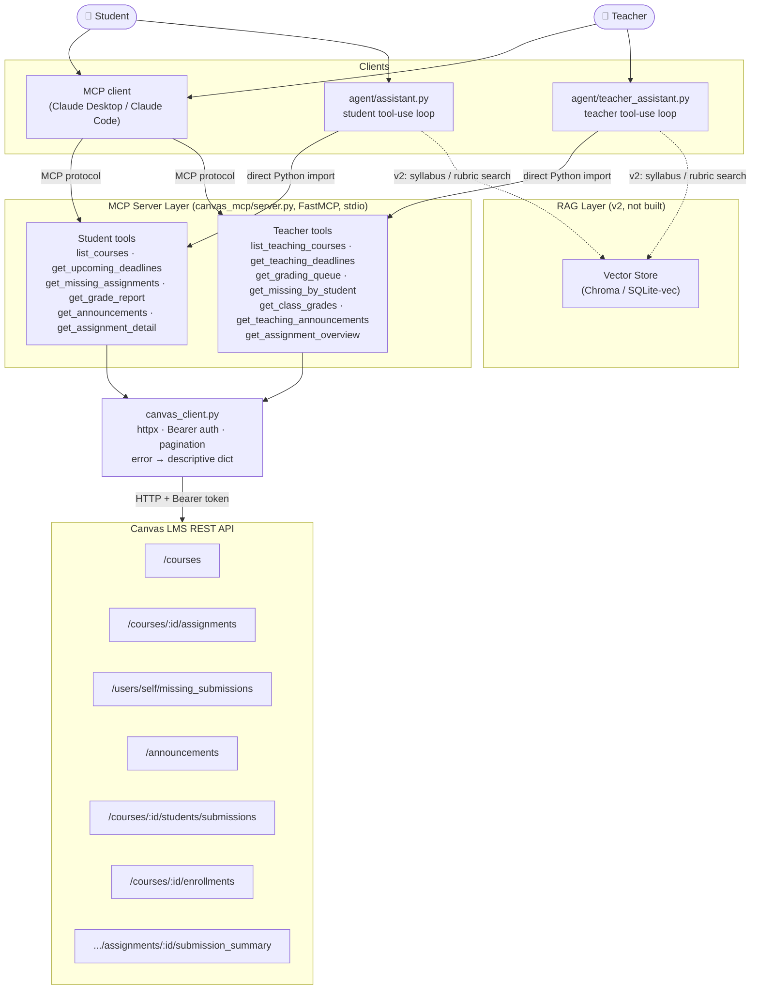

# Architecture: Canvas Academic Assistant

**Course:** ACS 4220 — AI Engineering  
**Project:** canvas-mcp — A Python MCP server + agentic assistants for Canvas LMS  
**Patterns Used:** MCP (Model Context Protocol) + Agent SDK (tool-use loop)  

---

## Problem Statement

Students waste time manually checking Canvas across multiple courses to piece together deadlines, grades, announcements, and missing work. There is no single conversational interface that lets a student ask "what do I need to do this week?" and get an accurate, cross-course answer grounded in live LMS data.

Instructors have the mirror-image problem: finding out what needs grading, which students are falling behind, and how a class is doing means clicking through the gradebook and each assignment's submissions page, course by course.

This project solves both with a Python MCP server that exposes Canvas LMS data as structured, read-only tools, plus two agentic assistants (one for students, one for teachers) that reason across those tools to answer natural language queries.

---

## System Diagram



The tool functions in `canvas_mcp/tools/` are plain async functions that take a `CanvasClient`. `server.py` wraps them as MCP tools; the two CLI assistants import the same functions directly and expose them to Claude through the Anthropic API's tool-use interface. So there is one implementation of each tool, shared by every client.

---

## Pattern 1: MCP (Model Context Protocol)

### Why this pattern fits

The core problem is **data access** — Canvas has a rich REST API but no natural language interface. MCP decouples the data layer from the reasoning layer. The LLM doesn't scrape HTML or hallucinate deadlines; it calls typed tools that return structured data. This makes every response grounded and verifiable.

MCP also means the server is **reusable across clients** — Claude Desktop, Claude Code, or any other MCP client can connect to the same server without changing the data layer.

### Student tools

| Tool | Canvas Endpoint | Returns |
|---|---|---|
| `list_courses` | `GET /courses` | Active course names + IDs |
| `get_upcoming_deadlines` | `GET /courses/:id/assignments` | Sorted deadline list, configurable lookahead |
| `get_missing_assignments` | `GET /users/self/missing_submissions` | Unsubmitted past-due work (excused items removed) |
| `get_grade_report` | `GET /courses?include[]=total_scores` | Current + final score per course (`null` if ungraded) |
| `get_announcements` | `GET /announcements` | Recent instructor posts, keyword-filterable |
| `get_assignment_detail` | `GET /courses/:id/assignments/:id` | Full instructions + rubric criteria |

### Teacher tools

| Tool | Canvas Endpoint | Returns |
|---|---|---|
| `list_teaching_courses` | `GET /courses?enrollment_type=teacher` | Active courses the user teaches |
| `get_teaching_deadlines` | `GET /courses/:id/assignments` | Upcoming deadlines across taught courses, with `needs_grading_count` |
| `get_grading_queue` | `GET /courses/:id/assignments` | Assignments with ungraded submissions, most ungraded first |
| `get_missing_by_student` | `GET /courses/:id/students/submissions` | Missing, non-excused work in one course, grouped by student |
| `get_class_grades` | `GET /courses/:id/enrollments?type[]=StudentEnrollment` | Each student's current score (`null` if ungraded), deduplicated across sections |
| `get_teaching_announcements` | `GET /announcements` | Recent announcements in taught courses, keyword-filterable |
| `get_assignment_overview` | `GET /courses/:id/assignments/:id` + `.../submission_summary` | Assignment detail + graded / ungraded / not-submitted counts |

The teacher tools reuse the student helpers wherever the logic is the same: `get_teaching_deadlines` uses the shared `_deadlines_for_courses` helper, `get_teaching_announcements` uses `_announcements_for_courses`, and `get_assignment_overview` builds on `get_assignment_detail`.

**Every tool is read-only.** None of them can grade, submit, post, or message anyone. This is deliberate: a conversational interface that can only read can't do damage from a misunderstood prompt.

All calls are authenticated with a Canvas personal access token stored in `.env`. No OAuth flow required for single-user personal use.

### Error handling

`canvas_client.py` is the single place that talks to Canvas. It follows pagination (`Link` headers) and converts every failure into a descriptive error dict instead of raising: 401 (bad token), 403 (forbidden, or a rate limit, which Canvas often reports as a 403), 404, 429, 5xx, network errors, and a missing token. Tools pass that dict straight back, so the LLM can explain the problem to the user. Cross-course fan-out tools skip a course that errors rather than failing the whole answer.

### Risk / Limitation

**Canvas instance variability.** Each institution configures Canvas differently. Some schools disable specific API endpoints at the admin level. The `missing_submissions` endpoint in particular is known to return inconsistent results depending on how instructors configure assignment visibility. Mitigation: the graceful error handling above, plus documenting in the README which tools depend on instructor or admin settings.

**Role scoping.** The teacher tools only see courses where the token's user has an active teacher enrollment. TAs and course designers won't see teaching courses, and a student token gets empty results.

---

## Pattern 2: Agent SDK (tool-use loop)

### Why this pattern fits

A single MCP tool call answers a narrow question. But most real queries are **multi-step**: "What should I study this weekend?" requires fetching upcoming deadlines, checking grades to identify weak courses, and synthesizing a prioritized plan. "Who's behind in my web class?" requires resolving which course "my web class" is before fetching missing work. That's an agentic workflow — the model decides which tools to call, in what order, and how to combine results.

### How it's built

Both assistants use the `anthropic` Python SDK's Messages API in a manual tool-use loop:

1. Send the question, system prompt, and tool schemas to Claude.
2. If Claude responds with `tool_use` blocks, dispatch each one to the matching tool function and send the results back as `tool_result` blocks.
3. Repeat until Claude ends its turn, then return the text answer.

| | Student (`agent/assistant.py`) | Teacher (`agent/teacher_assistant.py`) |
|---|---|---|
| Tools | 6 student tools | 7 teacher tools |
| Resolves course names with | `list_courses` | `list_teaching_courses` |
| Default question | "What do I need to do this week?" | "What needs grading this week?" |

The teacher assistant is a separate module with its own system prompt rather than a mode flag on the student assistant. That keeps each prompt focused, and the model is only offered the tools that make sense for the role.

### System prompt rules

The system prompts encode the behaviours the acceptance criteria depend on:

- **Resolve ambiguity first**: when the user names a course ("my CS class", "my 4220 section"), call the course-listing tool to get the exact ID before any course-specific tool. Never guess IDs.
- **Prefer bulk tools for broad queries**: cross-course tools (`get_upcoming_deadlines`, `get_grading_queue`, `get_teaching_deadlines`) over repeated per-course calls.
- **`null` is not zero**: a `null` score means nothing has been graded yet.
- **Explain errors plainly**: if a tool returns an error dict, describe it without showing raw codes.
- **Read-only**: the teacher assistant tells the user it can't grade or post, and points them to Canvas.

### Risk / Limitation

**Token cost and latency on fan-out queries.** A query like "give me a full status across all my courses" could fan out to several tool calls before the agent can respond. Each call adds latency and tokens. Mitigation: the cross-course tools fetch every course's assignments in parallel with `asyncio.gather` inside a single tool call, and the system prompts steer the agent toward those bulk tools.

---

## Pattern 3: RAG (v2 / Bonus — not built)

RAG is scoped to a v2 milestone. The core use case: students often want to ask questions about **syllabus content** — grading weights, late policies, project requirements — that live in uploaded PDF files, not in Canvas's structured API. A vector store (Chroma or `sqlite-vec`) seeded with course syllabi and rubric documents would let the agent answer "what's the late penalty in my databases course?" from grounded document context rather than hallucinating.

This is deferred because it requires a document ingestion pipeline and adds infrastructure complexity that isn't necessary for the core tools.

---

## Tech Stack

| Layer | Technology |
|---|---|
| MCP Server | Python 3.11+, `mcp` (Python SDK, FastMCP), `httpx` |
| Agents | `anthropic` Python SDK, manual tool-use loop |
| Canvas API | REST, Bearer token auth, `Link`-header pagination |
| Config | `python-dotenv`, `.env` file |
| Testing | `pytest`, `pytest-asyncio`, mocked Canvas responses |
| Runtime | stdio transport (Claude Desktop, Claude Code, any MCP client) |

---

## Repo Structure

```
canvasmcp/
├── canvas_mcp/
│   ├── __init__.py
│   ├── server.py                  # MCP server entry point (FastMCP); registers all 13 tools
│   ├── canvas_client.py           # httpx wrapper: auth, pagination, error handling
│   └── tools/
│       ├── assignments.py         # student: courses, deadlines, missing work, assignment detail
│       ├── grades.py              # student: grade report
│       ├── announcements.py       # student: announcements
│       ├── teacher_assignments.py # teacher: courses, deadlines, grading queue,
│       │                          #          missing by student, assignment overview
│       ├── teacher_grades.py      # teacher: class grades
│       └── teacher_announcements.py # teacher: announcements
├── agent/
│   ├── assistant.py               # student tool-use loop, system prompt, CLI
│   └── teacher_assistant.py       # teacher tool-use loop, system prompt, CLI
├── tests/
│   ├── test_assignments.py, test_grades.py, test_announcements.py
│   ├── test_teacher_assignments.py, test_teacher_grades.py, test_teacher_announcements.py
│   ├── test_canvas_client.py      # pagination + error mapping
│   ├── test_server.py             # startup time + tool registration
│   ├── test_agent.py, test_teacher_agent.py  # agent loops with a mocked Anthropic client
│   └── fixtures/                  # mocked Canvas API responses
├── .env.example
├── architecture.md
└── README.md
```

---

## Acceptance Criteria (Spec with Teeth)

- [x] `get_upcoming_deadlines(days=7)` returns correctly sorted results across ≥2 active courses
- [x] `get_missing_assignments` returns only unsubmitted, past-due items (not excused)
- [x] `get_grade_report` returns current score as a float; handles courses with no grades yet (returns `null`, not crash)
- [x] Agent correctly resolves ambiguous course references (e.g., "my CS class") via `list_courses` before fetching
- [x] All tools handle Canvas API errors (401, 404, 429) gracefully with descriptive messages
- [x] Test suite covers happy path + error path for each tool using mocked HTTP responses
- [x] Server starts in <2 seconds (tested); individual tool calls complete in <3 seconds on a typical Canvas instance

Teacher extension, held to the same bar:

- [x] Teacher tools only return courses with an active teacher enrollment
- [x] `get_missing_by_student` excludes excused and submitted work and groups by student
- [x] `get_class_grades` returns current score as a float, or `null` when nothing is graded
- [x] Teacher agent resolves course names via `list_teaching_courses` before course-specific tools
- [x] Every teacher tool has happy-path and error-path tests with mocked HTTP responses

---

## Milestones

| Week | Deliverable | Status |
|---|---|---|
| 1 | MCP server with `list_courses`, `get_upcoming_deadlines`, `get_missing_assignments` | Done |
| 2 | Add `get_grade_report`, `get_announcements`, `get_assignment_detail` + test suite | Done |
| 3 | Agent SDK loop, system prompt, multi-step query handling | Done |
| 4 | Polish, docs, presentation prep | Done |
| Extension | Read-only teacher tools, teacher assistant, tests | Done |
| v2 | RAG over syllabi and rubrics | Not started |
